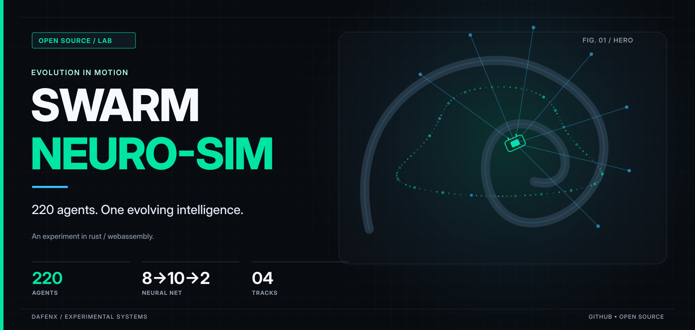
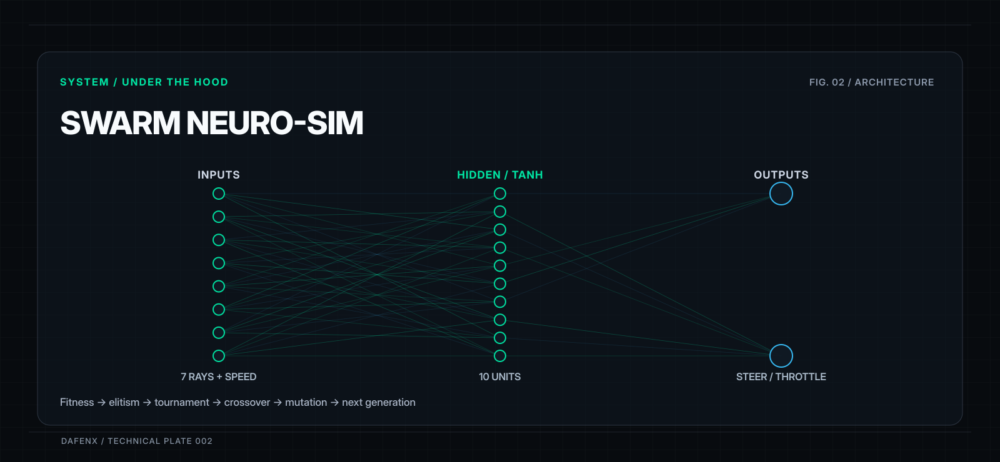

<p align="center">
  
</p>

<p align="center">
  <a href="https://github.com/Dafenxz0/swarm-neuro-sim/actions/workflows/ci.yml"></a>
  <a href="https://dafenxz0.github.io/swarm-neuro-sim/"></a>
</p>

# Swarm Neuro-Sim

### Evolution you can watch, inspect and interrupt.

A browser-based neuroevolution lab powered by **pure Rust compiled to WebAssembly**. A population of **220 autonomous agents** learns to navigate obstacles while you inspect the live neural network, shape the track and watch fitness evolve.

<p align="center"><a href="https://dafenxz0.github.io/swarm-neuro-sim/"><strong>LAUNCH LIVE SIMULATION</strong></a> · <a href="https://github.com/Dafenxz0/swarm-neuro-sim/actions/workflows/ci.yml">CI</a></p>



## Inside the simulation

Each agent receives **7 forward raycast distances + normalized speed**, passes the **8-dimensional input** through an `8 → 10 → 2` tanh network and outputs **steering** and **throttle**. Generations evolve with fitness evaluation, elitism (about 6%), tournament selection, crossover and Gaussian mutation.

| Part | Role |
| --- | --- |
| [`src/nn.rs`](src/nn.rs) | Compact fixed-size neural network, weights, crossover and mutation |
| [`src/sim.rs`](src/sim.rs) | Population dynamics, fitness, generational selection |
| [`src/track.rs`](src/track.rs) | Ray–wall intersections, gates, collisions and presets |
| [`src/lib.rs`](src/lib.rs) | WASM C ABI and flat telemetry memory buffers |
| [`web/app.js`](web/app.js) | Canvas renderer, neural-network inspector and fitness charts |

### Live experiments

- Switch between **Circuit Oval**, **Technical S-Curves**, **Spiral Gauntlet** and **Open Slalom**.
- Add walls with a drag or erase them while the population is running.
- Watch the fittest agent's neuron activations and connection weights, plus the best/mean fitness graph.
- Use `1×`, `5×` or `20×` simulation speed.

The web interface reads Rust's `f32` telemetry buffers through typed-array views of `wasm.memory.buffer`, rather than allocating a JavaScript object for every agent every frame.

## Try the live demo

**[Open the simulation →](https://dafenxz0.github.io/swarm-neuro-sim/)**. No local setup required.

### Controls

| Input | Action |
| --- | --- |
| `Space` | Pause / resume |
| `1` / `2` / `3` | 1× / 5× / 20× |
| `D` / `E` | Draw / erase tool |
| Left-drag | Draw custom wall segments |
| Right-drag | Erase walls |
| `R` | Reset population |

## Build from source

Requires a stable Rust toolchain with the WASM target and a simple local HTTP server.

```bash
git clone https://github.com/Dafenxz0/swarm-neuro-sim.git
cd swarm-neuro-sim
rustup target add wasm32-unknown-unknown
cargo test
cargo build --target wasm32-unknown-unknown --release
cp target/wasm32-unknown-unknown/release/swarm_neuro_sim.wasm web/swarm_neuro_sim.wasm
python3 -m http.server --directory web 8080
```

Open `http://localhost:8080`. Run Clippy and formatting checks with `cargo clippy --all-targets -- -D warnings` and `cargo fmt --all -- --check`.

## What this is (and isn't)

A **visual neuroevolution experiment** with compact feed-forward networks, not a general reinforcement-learning framework. Motion speed and visible frame rate depend on the browser and device. The simulator and weights are reproducible within the project’s deterministic RNG design, though interactive runs depend on your actions.

**Visual assets:** the architecture diagram above is schematic, showing the implemented input/hidden/output widths; it is not a screenshot of current weights.
